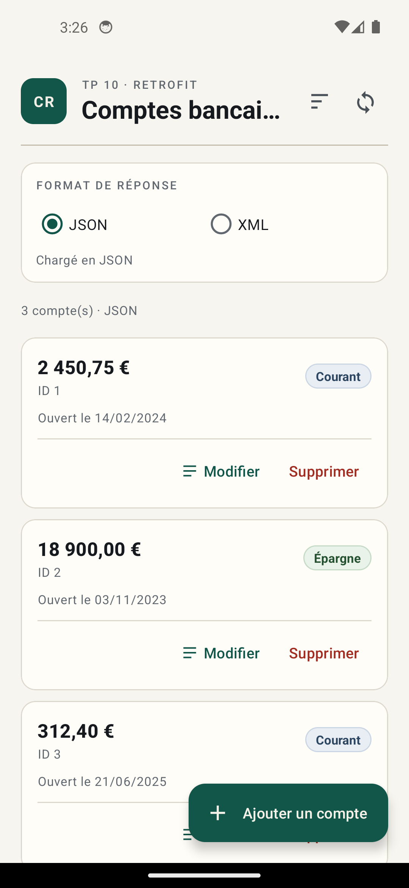
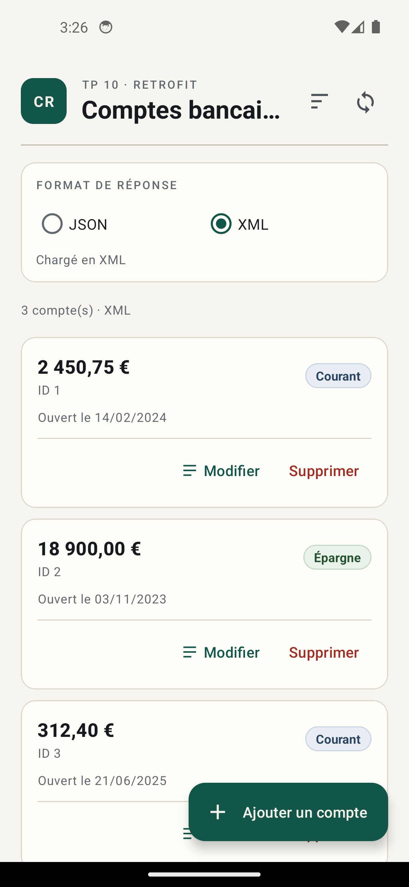
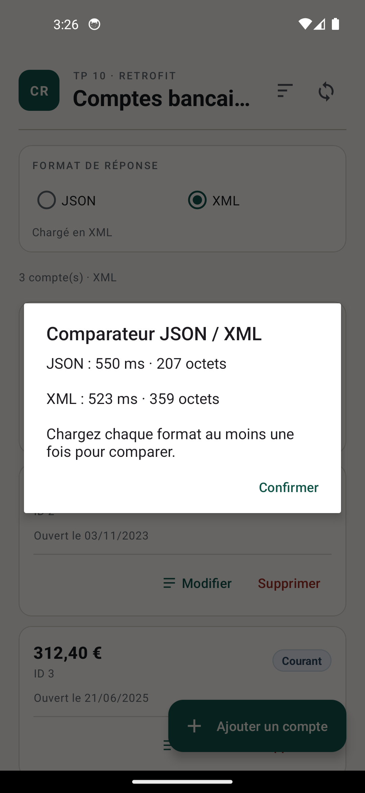
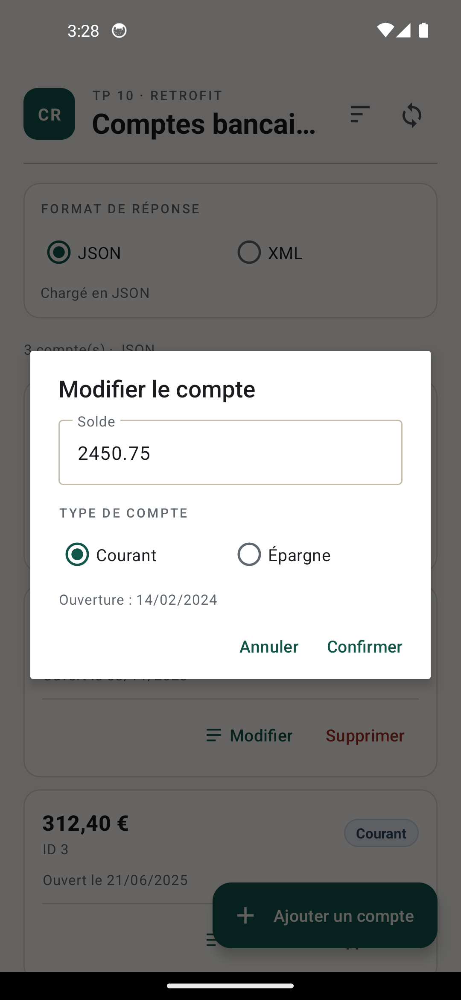
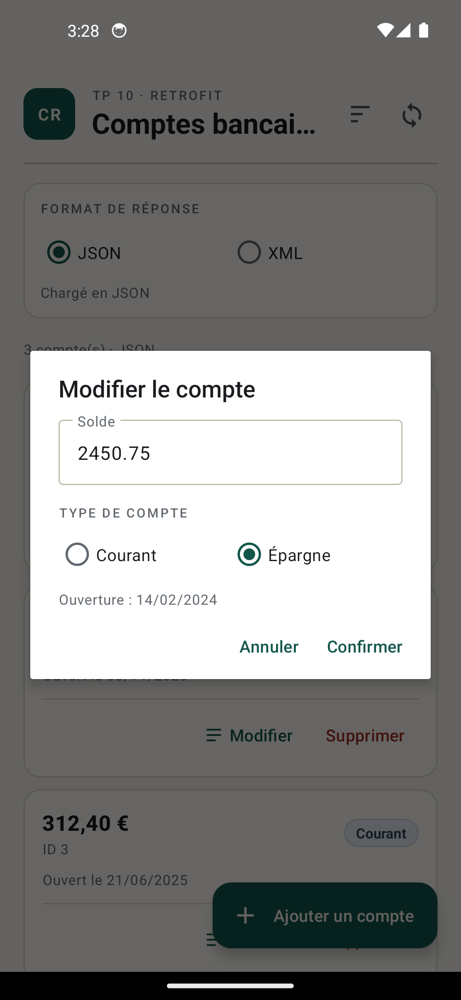
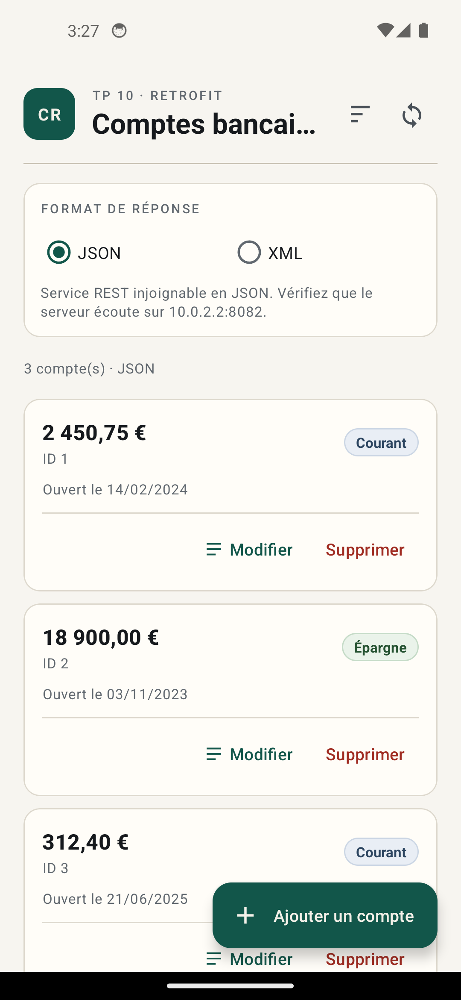
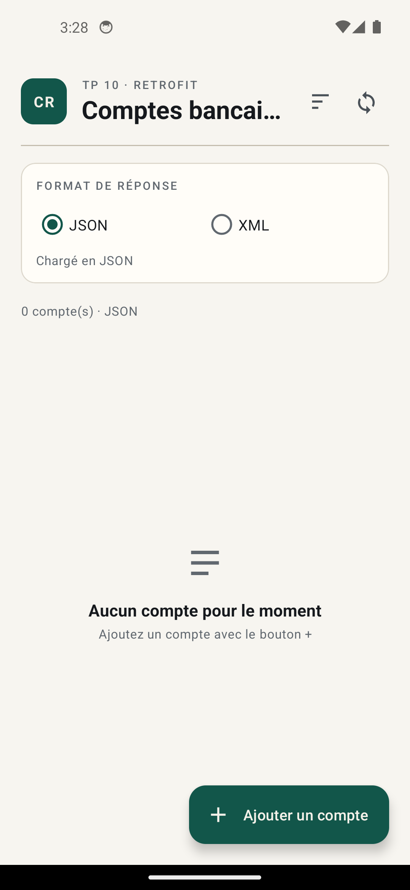

# TP 10 - Client REST Android Retrofit (XML & JSON)

## Liste des comptes - format JSON

## Liste des comptes - format XML

## Comparateur JSON / XML

## Dialogue d ajout

## Dialogue de modification

## Confirmation de suppression

## Mode hors ligne avec cache local

## Etat vide

